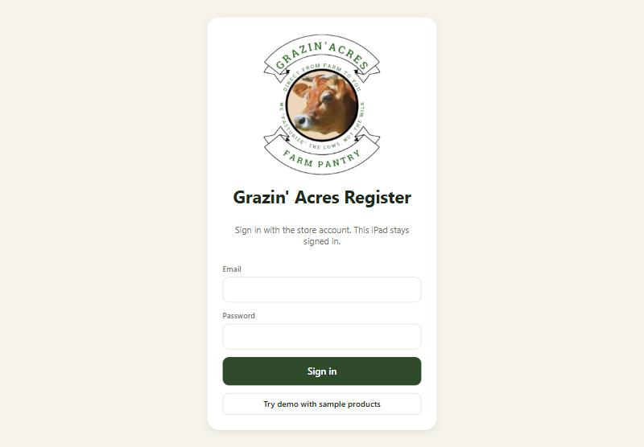
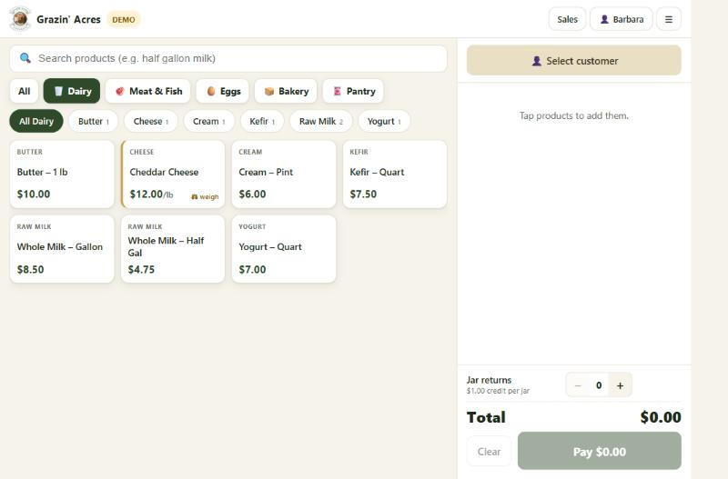
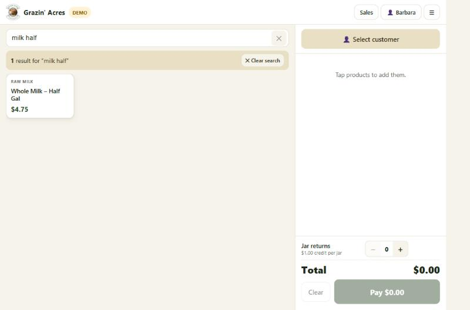
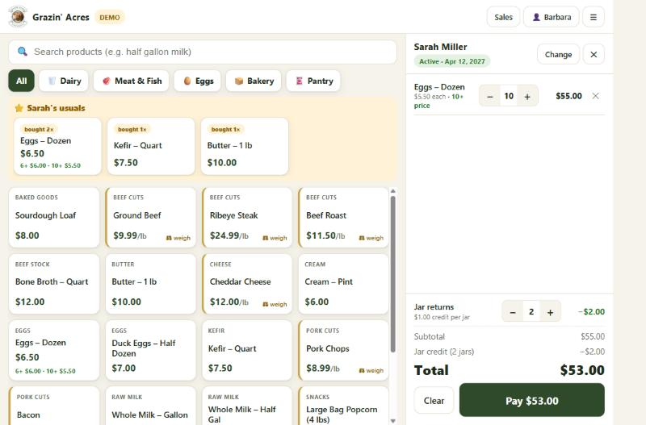
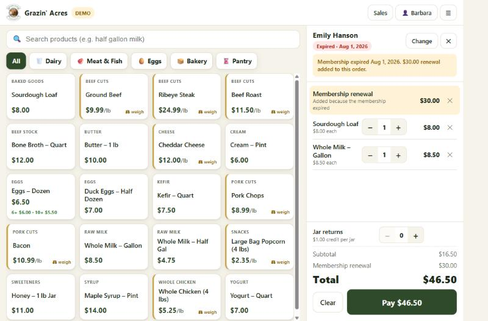
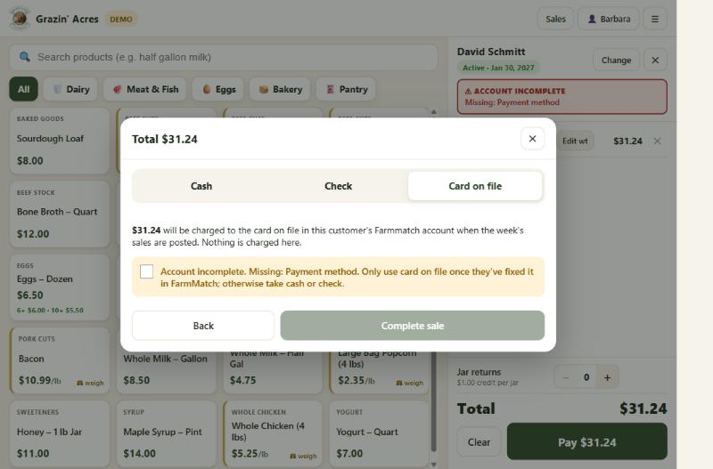
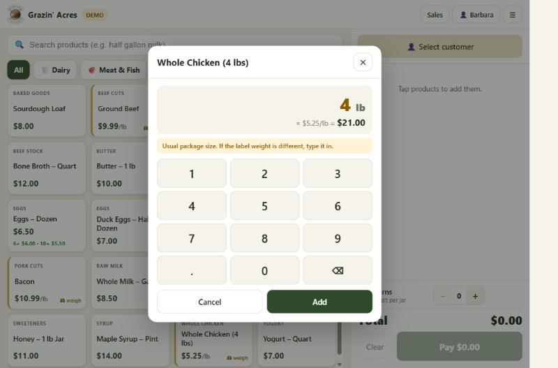
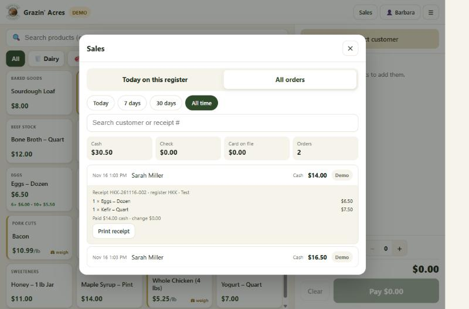

# Grazin' Acres Register: what it does

An iPad checkout for the Grazin' Acres Farm Pantry. It's connected to the register database and kept in sync with FarmMatch by your agent. Screenshots are from demo mode, so the names and prices are sample data.

---

## Sign in and branding
The Grazin' Acres Farm Pantry logo is on the sign-in screen, in the top bar, on printed receipts and on the iPad home-screen icon. **Try demo with sample products** opens a safe practice mode that never touches real sales.

## Finding products
- **Departments instead of 64 categories:** Specials, Dairy, Meat & Fish, Eggs, Bakery, Pantry, Drinks, Household. Picking one shows its categories underneath, with counts. New FarmMatch categories sort themselves into a department by name.
- **Preorder items are hidden** from the register (beef/pork/lamb wholes and halves, "Preorder and Prepay" fish shares). The rules live in the database, so next season's preorders are hidden automatically.

- **Smarter search:** words in any order ("milk half" finds "Whole Milk – Half Gal"), singular or plural, accents ignored, part-words ("yog"), and category names ("chicken thighs"). Best matches come first, with a results bar and ✕ Clear.

## Customer's usuals, bulk pricing and jar returns
- **Usuals:** picking a customer shows **"⭐ Sarah's usuals"**, their most-bought items from past register sales, each with a "bought 2×" badge. One tap adds the item.
- **Quantity tier pricing** from FarmMatch: tiles show the price breaks ("6+ $6.00 · 10+ $5.50"). Each line's price follows its quantity ("$5.50 each · 10+ price") and hints at the next break.
- **Jar returns:** a − / + counter takes $1 per jar off the order. It never goes below $0.

## Membership renewals
Picking a customer whose membership has **expired** automatically adds a **$30 Membership renewal** (the cashier can remove it with ✕). Customers renewing soon, or with no membership on file, get a "+ Add renewal" button. After paying they show as **Renewed in store**, so they aren't charged twice before FarmMatch updates.

## Account warnings from the agent
The FarmMatch agent can flag a customer's account. The cashier sees **⚠ ACCOUNT INCOMPLETE / Missing: Payment method** (or whatever is missing) in red in the cart and in the customer search. Card-on-file payments ask the cashier to confirm, or to take cash or check. Warnings are kept to 60 characters.

## Weighed items
The weight pad pre-fills the usual package size from the product name ("Whole Chicken (4 lbs)" → 4 lb = $21.00). The cashier taps Add, or types the label weight.

## Sales and all orders
**Sales** has two tabs: **Today on this register** (with void), and **All orders** across every register and day. All orders has date ranges, search by customer or receipt #, totals by payment type, FarmMatch posting status on each order, item details and receipt reprint.

---

## Also included
- **Payments:** cash with change and quick-cash buttons, check (with number), and card on file (charged in FarmMatch at the weekly posting). Printed receipts.
- **Offline:** sales are saved on the iPad and upload when the connection is back. Products and members are kept for offline use and refresh every 30 minutes, or right away from ☰ → Update products & members now.
- **New FarmMatch signups** at the counter can check out right away. Their sale is linked to their account at the next sync.
- **Database safety:** sales math is checked on the server, a sync that would hide more than 20% of products or members is refused, and dry runs are available. The register login can only read data and ring up sales.
- **Agent tools:** the `register` command-line tool and `docs/AGENT_SPEC.md` (sync, posting, warnings). There's also an importer for FarmMatch's customer report.
